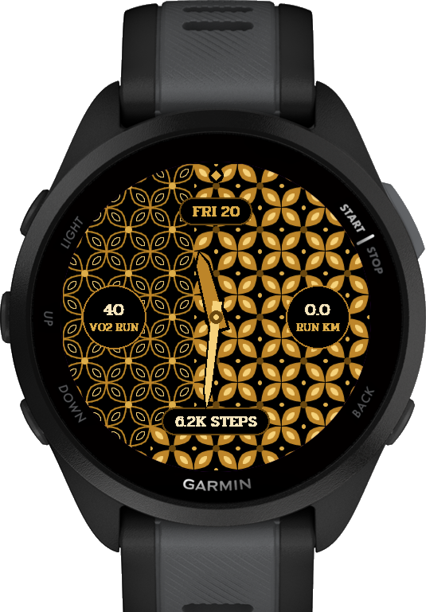
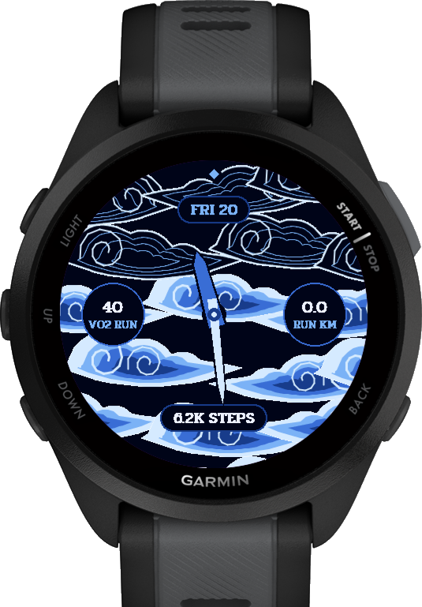
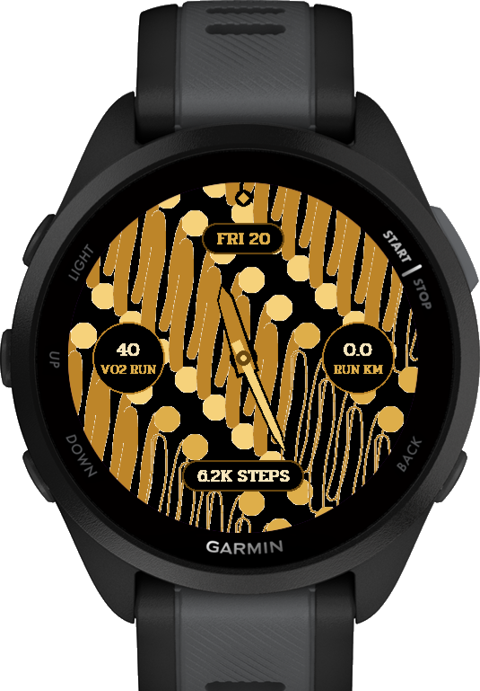
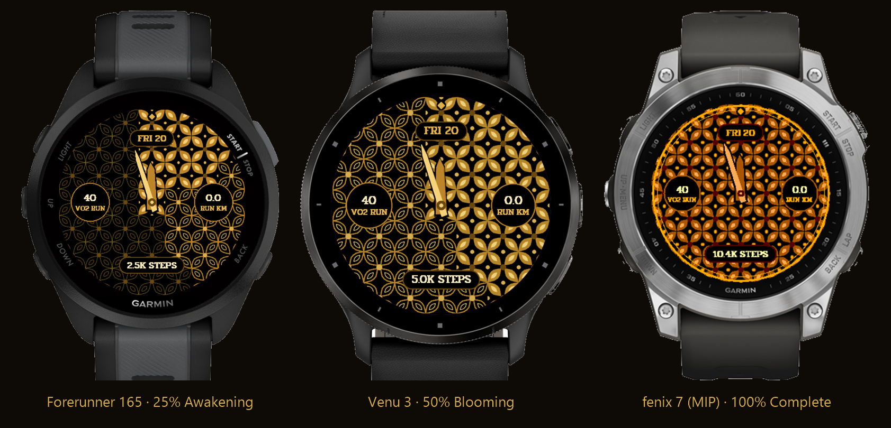
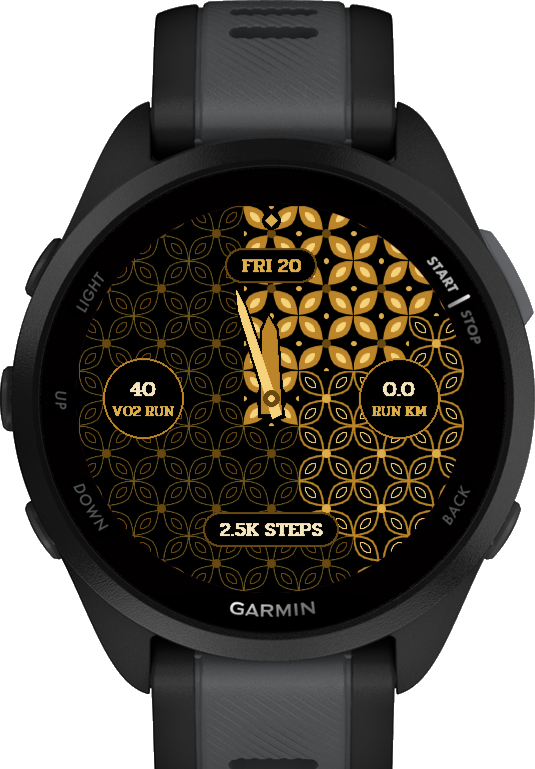
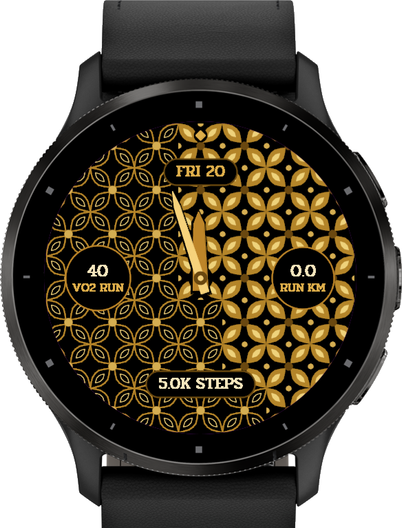
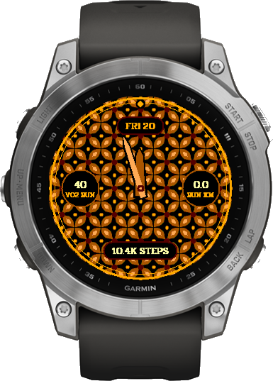

# Nusantara Batik Watchfaces

Tiga watch face Connect IQ dengan motif batik Indonesia:

| Varian | Folder |
|---|---|
| Kawung | `nusantara-kawung/` |
| Megamendung | `nusantara-megamendung/` |
| Parang | `nusantara-parang/` |

## Galeri

Tampilan utama di FR165:

| Kawung | Megamendung | Parang |
|---|---|---|
|  |  |  |

Motif hidup (living pattern) Kawung di tiga perangkat:



| FR165 | Venu 3 | Fenix 7 |
|---|---|---|
|  |  |  |

Mockup Tambahan: [Kawung](nusantara-kawung/docs/mockups/) · [Megamendung](nusantara-megamendung/docs/mockups/) · [Parang](nusantara-parang/docs/mockups/)

## Build

Jalankan dari folder varian:

```sh
monkeyc -f monkey.jungle -d fr165 -o bin/<nama>.prg -y developer_key.der
monkeydo bin/<nama>.prg fr165
```

Unit test tersedia di `nusantara-kawung/test/LivingTest.mc` dan diaktifkan lewat `base.sourcePath = source;test` pada `monkey.jungle`.

## Aset

- `fonts/` berisi font Pridi dan `OFL.txt` (lisensi font).
- `docs/batik-pattern-reference.jpg` adalah referensi visual motif.

Kunci developer dan hasil build sengaja tidak disertakan.
