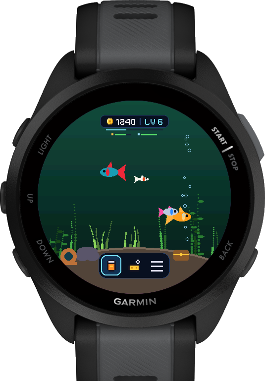
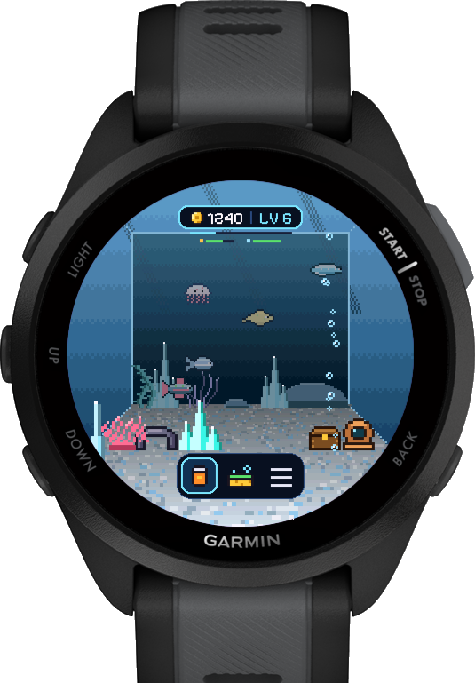
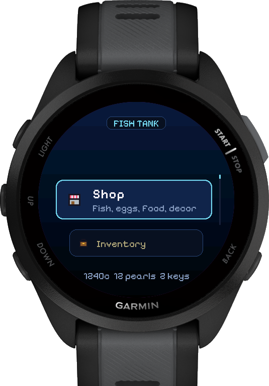
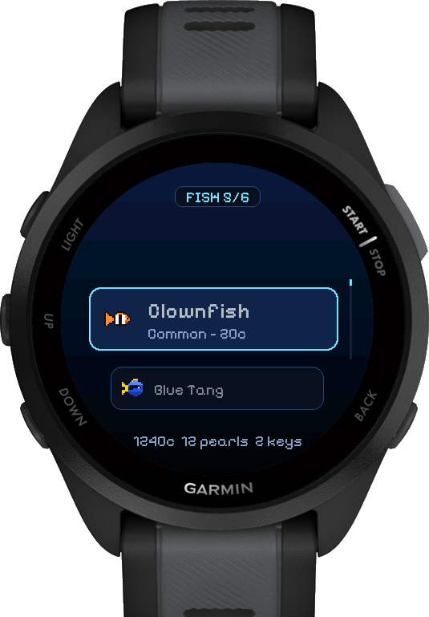
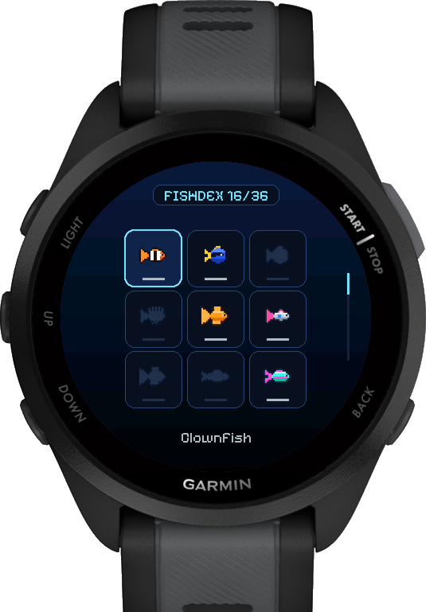
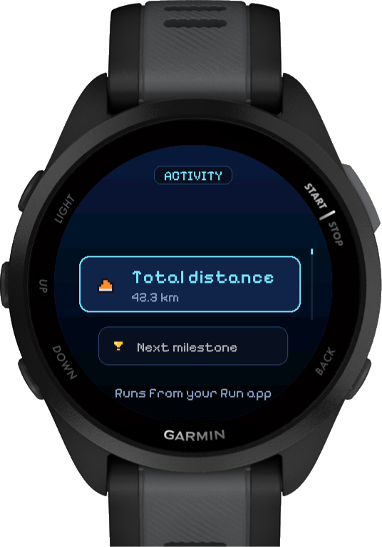
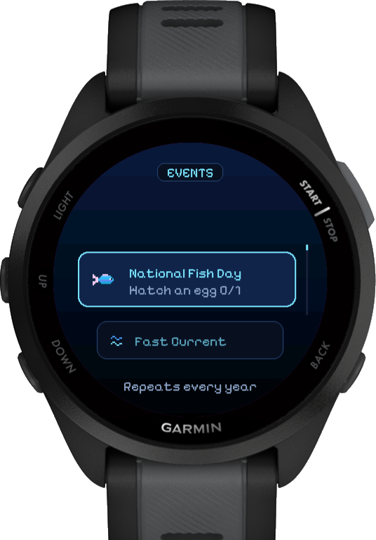
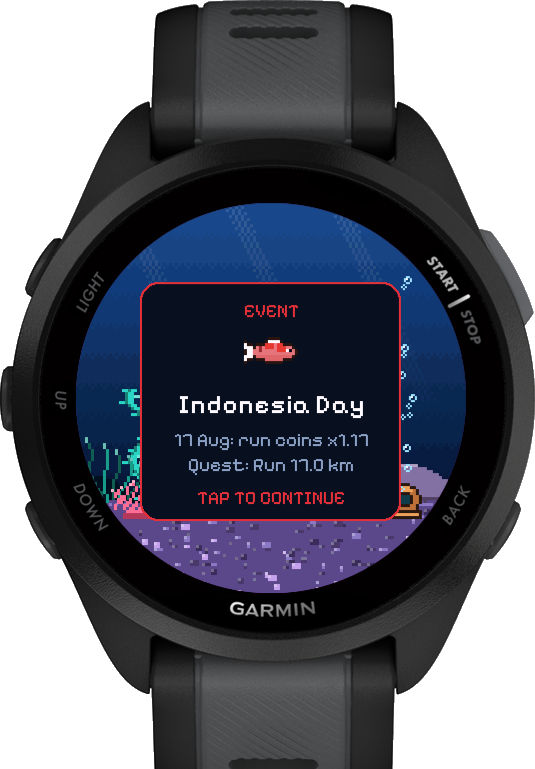
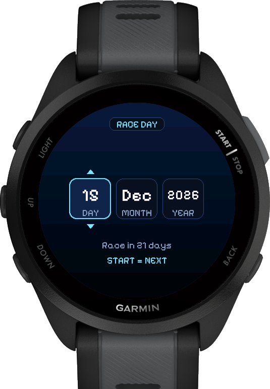
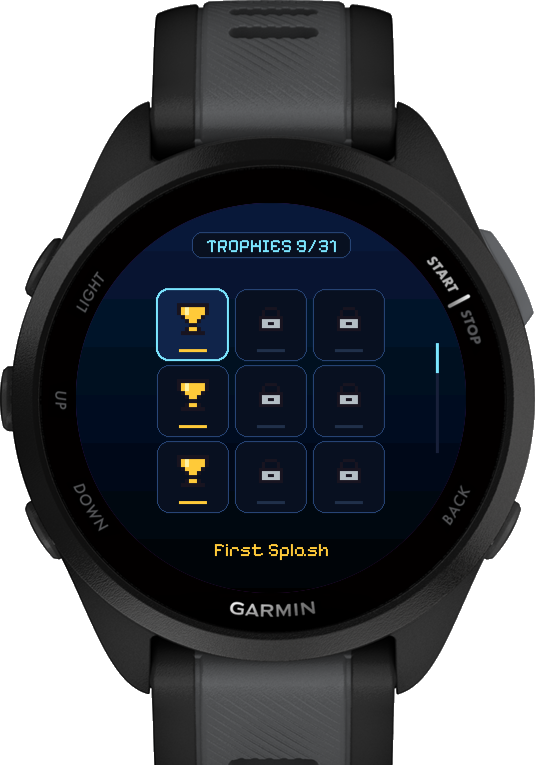

# FISH TANK: Pocket Aquarium

Connect IQ device app untuk 63 jam Garmin berlayar bulat, AMOLED (360–454 px) maupun MIP (218–280 px): Forerunner 165/170/255/265/570/955/965/970, fēnix 7/7S/7X (+ Pro), fēnix 8/9 (+ Pro/Solar), fēnix E, epix Gen 2 / Pro, Enduro 2/3/4, Venu 2/2S/2 Plus/3/4, vívoactive 5/6, MARQ 2/3, Instinct 3/E/Crossover, D2 Mach, Approach S70. Akuarium pixel-art yang dirawat, dikoleksi dan didekorasi. Koin utamanya datang dari lari: lari dengan app Run bawaan Garmin, lalu buka FISH TANK dan setiap lari baru dibayar satu kali (100 m = 1 koin, maks 300/hari).

> Build note: paket 59 device saat ini belum menyertakan Enduro 2 dan Venu 2/2S/2 Plus karena definisi device-nya belum ter-install di SDK 9.3; manifest sudah mencakup 63 device.


## Fitur
- **Move:** Run-to-Earn dari riwayat aktivitas (lari dan langkah di minggu pemasangan ikut dihitung, termasuk sebelum app dipasang, jadi quest yang sudah terpenuhi langsung beres), Step Hunter (3k/5k/8k/10k), consistency streak mingguan, distance milestone 25–500 km, Activity Journal.
- **Collect:** 36 spesies di 5 habitat, Fishdex, telur yang menetas lebih cepat kalau lari, varian Shiny/Golden/Ghost/Giant, personality, level ikan, evolusi, breeding.
- **Care + Build:** makan (makanan favorit), bersih, habitat synergy, 16 dekorasi di Build mode, aquarium level 1–5, rating bintang.
- **Explore:** 5 region ekspedisi (2 membuka tema baru), mini-game Bubble Pop, Treasure Dive, Fish Racing.
- **Compete:** quest harian/mingguan, 33 trophy, Aquarium League pribadi.
- **Events (tanpa update, berulang tiap tahun):** 15 event tahunan (Tahun Baru, HUT RI, Hari Batik, Halloween, dll.), Ramadan, Idul Fitri dan Imlek yang tanggalnya dihitung otomatis, event pribadi (Race Day, ulang tahun, anniversary tank), dan rotasi mingguan "Arus Minggu Ini" (arus, ikan unggulan, pengunjung, mini-game sorotan). Setiap event punya quest dengan ikan edisi khusus.
- **Performa:** frame rate adaptif (15/12/10/7,5 fps sesuai kemampuan jam), gerakan berbasis waktu nyata, pekerjaan per menit dan autosave dipecah ke beberapa frame.
- **Tampilan:** 3 art style (Modern Pixel, Minimalist, Pseudo-3D) × 6 tema, font Pixelify Sans, menu pixel custom.
- **Glance:** tekan UP/DOWN dari watch face untuk melihat koin, level dan mini tank di daftar glance. Buka glance untuk langsung masuk ke akuarium.

## Screenshot

| Modern Pixel | Minimalist | Pseudo-3D |
|---|---|---|
|  |  |  |

| Menu | Shop | Fishdex |
|---|---|---|
|  |  |  |

| Run reward | Quests | Activity |
|---|---|---|
|  |  |  |

| Events | Event card | Race Day |
|---|---|---|
|  |  |  |

| Bubble Pop | Treasure Dive | Fish Racing |
|---|---|---|
|  |  |  |

| Expedition | Trophies | Build mode |
|---|---|---|
|  |  |  |

Semua screenshot ada di [`docs/screens/`](docs/screens/).

## Multi-device
Semua layout ditulis untuk kanvas 390×390 (FR165). Di layar lain `source/UI/Scale.mc` memetakan kanvas itu ke layar asli (koordinat gambar dan titik sentuh); di layar 390 tidak ada lapisan tambahan. Font Pixelify Sans dibuat per resolusi (`resources-round-WxH/fonts` untuk 218, 240, 260, 280, 360, 416 dan 454, dari `tools/make-fonts.py`) supaya teks tetap tajam; layar kecil memakai ukuran minimum yang masih terbaca dan ukuran yang rusak oleh hinting (12, 17, 18 px) dilewati. Di layar MIP 64 warna, gradien air yang terlalu gelap diangkat sedikit (`PixelKit.water`) supaya tidak jadi hitam.

Menambah jam bulat lain: tambahkan `<iq:product>` di `manifest.xml` (beberapa kandidat yang ID-nya belum diverifikasi ada di komentar di sana). Kalau resolusinya baru, tambahkan ke `SCREENS` di `tools/make-fonts.py` lalu jalankan `python -I tools/make-fonts.py --scaled`.

## Build & test

```powershell
.\tools\build.ps1            # build semua jam di manifest ke bin\
.\tools\build.ps1 -Only fr965 # satu jam saja
.\tools\build.ps1 -Run       # build dan jalankan di simulator
.\tools\build.ps1 -Test      # unit test di simulator
.\tools\capture.ps1 -Matrix  # screenshot semua style x tema
.\tools\capture.ps1 -Screens -Device fr965   # cek tampilan di jam lain
.\tools\capture.ps1 -Screens # screenshot semua menu dan mini-game
```

Font: Pixelify Sans oleh Stefie Justprince, SIL Open Font License 1.1 ([`fonts/src/OFL.txt`](fonts/src/OFL.txt)).
