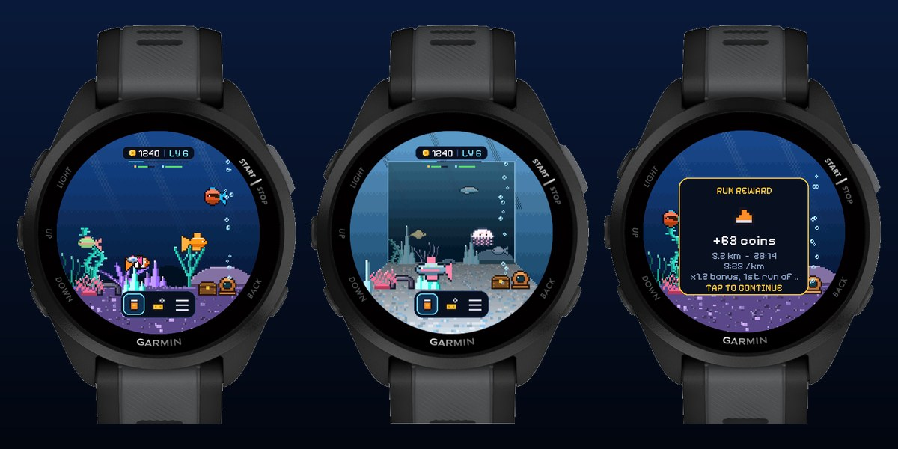
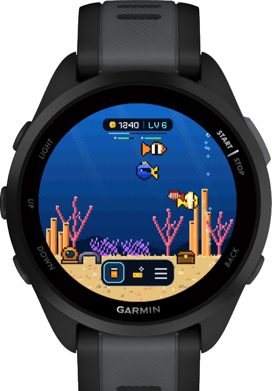
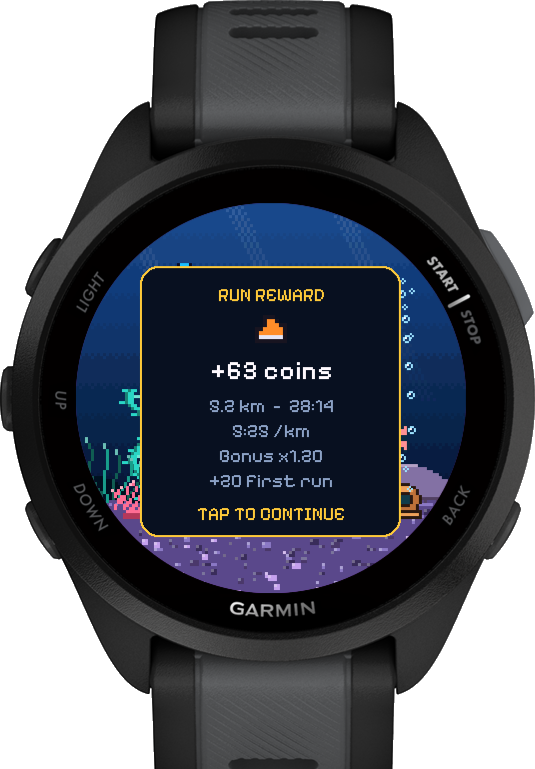
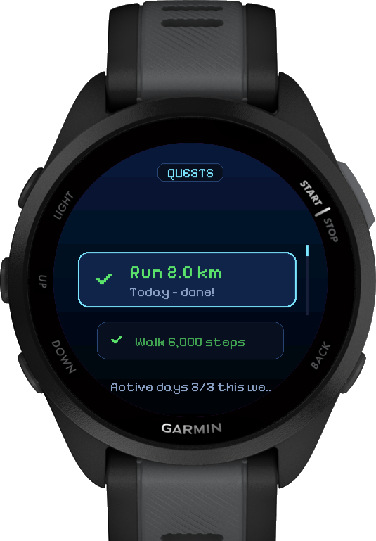
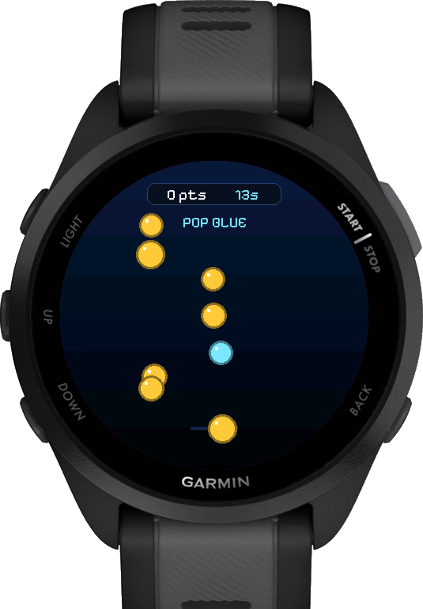
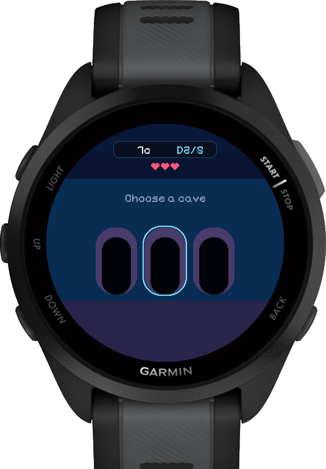
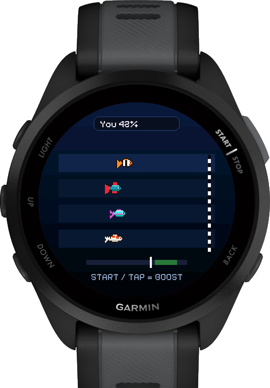
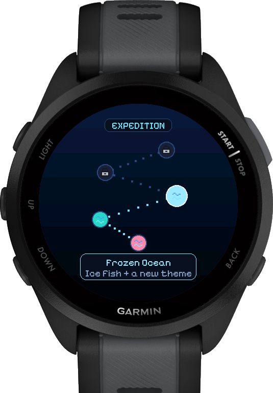
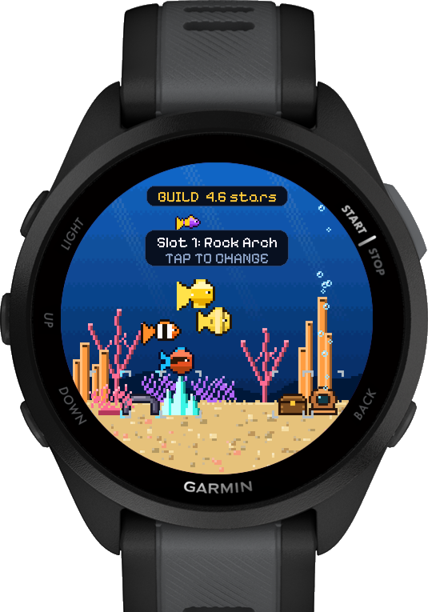

# FISH TANK: Pocket Aquarium

Connect IQ device app untuk Forerunner 165 / 165 Music (390×390 AMOLED). Akuarium pixel-art yang dirawat, dikoleksi dan didekorasi. Koin utamanya datang dari lari: lari dengan app Run bawaan Garmin, lalu buka FISH TANK dan setiap lari baru dibayar satu kali (100 m = 1 koin, maks 300/hari).



## Fitur
- **Move:** Run-to-Earn dari riwayat aktivitas, Step Hunter (3k/5k/8k/10k), consistency streak mingguan, distance milestone 25–500 km, Activity Journal.
- **Collect:** 36 spesies di 5 habitat, Fishdex, telur yang menetas lebih cepat kalau lari, varian Shiny/Golden/Ghost/Giant, personality, level ikan, evolusi, breeding.
- **Care + Build:** makan (makanan favorit), bersih, habitat synergy, 16 dekorasi di Build mode, aquarium level 1–5, rating bintang.
- **Explore:** 5 region ekspedisi (2 membuka tema baru), mini-game Bubble Pop, Treasure Dive, Fish Racing.
- **Compete:** quest harian/mingguan, 33 trophy, Aquarium League pribadi.
- **Events (tanpa update, berulang tiap tahun):** 15 event tahunan (Tahun Baru, HUT RI, Hari Batik, Halloween, dll.), Ramadan, Idul Fitri dan Imlek yang tanggalnya dihitung otomatis, event pribadi (Race Day, ulang tahun, anniversary tank), dan rotasi mingguan "Arus Minggu Ini" (arus, ikan unggulan, pengunjung, mini-game sorotan). Setiap event punya quest dengan ikan edisi khusus.
- **Tampilan:** 3 art style (Modern Pixel, Minimalist, Pseudo-3D) × 6 tema, font Pixelify Sans, menu pixel custom.

## Screenshot

| Modern Pixel | Minimalist | Pseudo-3D |
|---|---|---|
|  |  |  |

| Menu | Shop | Fishdex |
|---|---|---|
|  |  |  |

| Run reward | Quests | Activity |
|---|---|---|
|  |  |  |

| Events | Event card | Race Day |
|---|---|---|
|  |  |  |

| Bubble Pop | Treasure Dive | Fish Racing |
|---|---|---|
|  |  |  |

| Expedition | Trophies | Build mode |
|---|---|---|
|  |  |  |

Semua screenshot ada di [`docs/screens/`](docs/screens/).

## Build & test

```powershell
.\tools\build.ps1            # build fr165 + fr165m ke bin\
.\tools\build.ps1 -Run       # build dan jalankan di simulator
.\tools\build.ps1 -Test      # unit test di simulator
.\tools\capture.ps1 -Matrix  # screenshot semua style x tema
.\tools\capture.ps1 -Screens # screenshot semua menu dan mini-game
```

Font: Pixelify Sans oleh Stefie Justprince, SIL Open Font License 1.1 ([`fonts/src/OFL.txt`](fonts/src/OFL.txt)).
