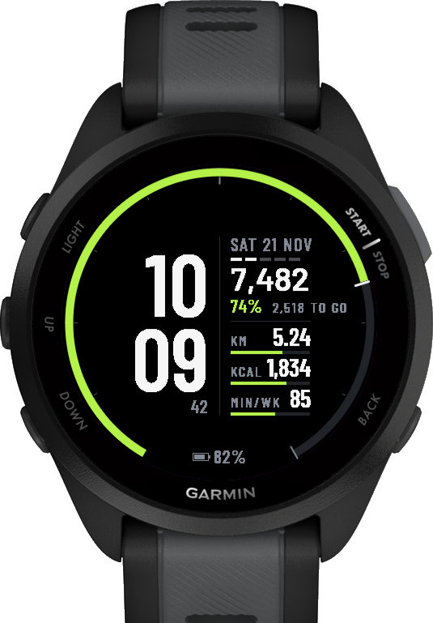
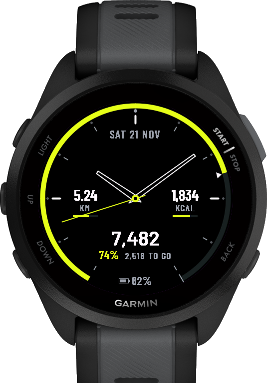
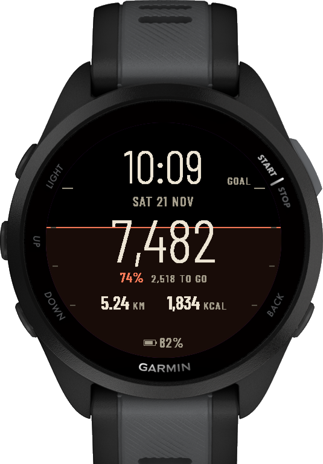
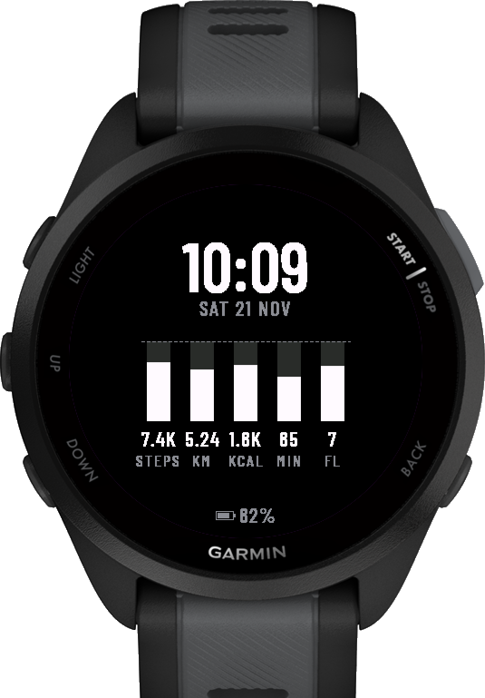
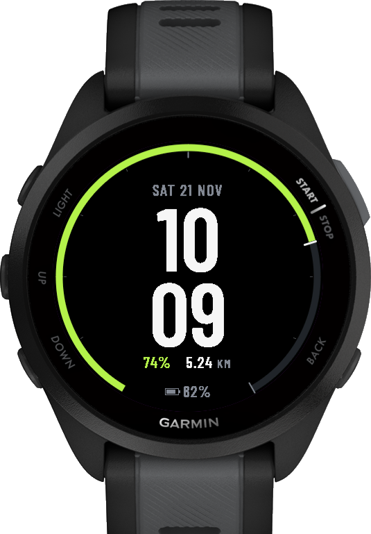
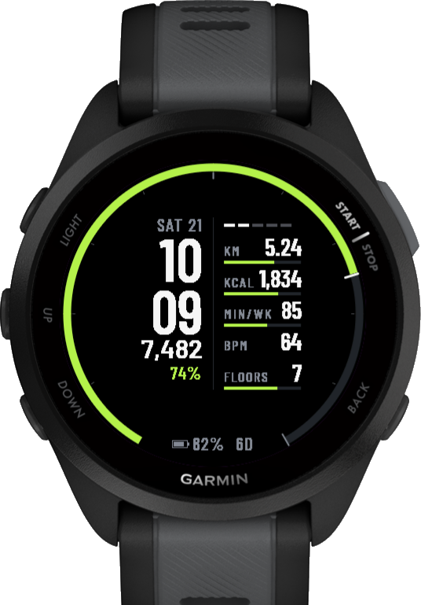
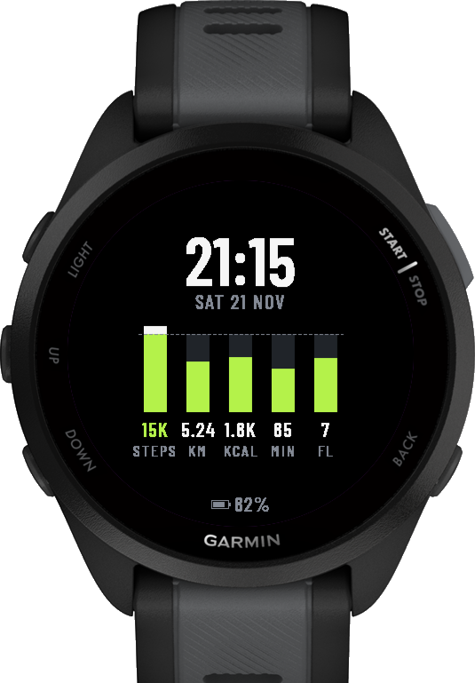
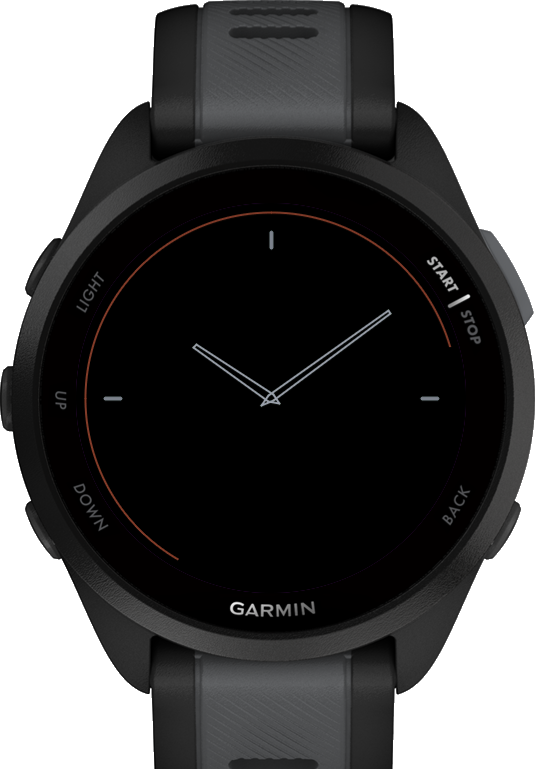

# PULSEFORM: activity goal watch face (Garmin Forerunner 165)

*Make every move count.*

PULSEFORM is an original Connect IQ watch face.
GOALS (VAW.BE) was used only as a benchmark for the product category. No code, assets, layout or branding were taken from it.

The design is a split instrument (reasons in `docs/DESIGN-NOTES.md`):
- **Spine**: a vertical hairline divides *time* (left) from *readings* (right).
- **Stacked time**: hours above minutes, right-aligned to the spine.
- **Readout rows**: a label on the left, the value on the right, the goal bar underneath.

The goal display is **GOAL TRACK**:
- A 300° step track runs around the bezel, with a 10 % scale, a white **needle** at the exact position, and a marker where 100 % lands.
- Going past the goal draws a separate inner **lap**. The lap length is the real overshoot: 150 % gives half a lap.
- Five visual states come from the percentage only: START, BUILDING, NEAR, COMPLETED and OVER.

Contents:
- `docs/CAPABILITY_MATRIX.md`: which metric comes from which API, and why.
- `docs/PLAN.md`: structure, risks and milestones.
- `docs/DESIGN-NOTES.md`: design read, dials, identity motif and the reason for each decision.
- `docs/contact-sheet.png`: every QA state rendered in the simulator.

## Screenshots

| Carbon · Balanced | Reflective · Dial | Field · Horizon | Signal · Stack |
|---|---|---|---|
|  |  |  |  |
| **Minimal** | **Data Dense** | **Goal 150 %** | **Always-On** |
|  |  |  |  |

All states: [`docs/screens/`](docs/screens/) and [`docs/contact-sheet.png`](docs/contact-sheet.png).

## Features (v0.1.0)
| Area | What is there |
|---|---|
| Faces | **Balanced** (default), **Minimal**, **Data Dense**, **Dial** (analog hands over the goal track), **Horizon** (a level rising to a GOAL line), **Stack** (one column per goal against a 100 % line) |
| Goal track | Circular (with scale and needle), segmented (10 × 10 %, plus needle) or linear (the spine becomes a vertical gauge). Overshoot lap and completion marker. Three thicknesses. |
| Steps | Count, goal (Garmin's or custom), floor percentage (never rounded up to 100 %), remaining steps, overshoot. |
| Metrics | Distance (km/mi from the watch setting, optional target), total kcal (optional target), weekly intensity minutes (Garmin goal or custom), heart rate (greyed when the last sample is older than 10 min), floors (only when the watch reports them), move bar, battery % plus days left (Dense). |
| Clock | Follows the watch's 12/24 h setting or a setting override. AM/PM marker. Seconds while awake. Date and weekday. |
| Looks | **Carbon**, **Reflective** (outline numerals, dashed rules, chevron needle), **Field** (light numerals, warm palette, no rules), **Signal** (monochrome until the goal is met, then red). Accent: the look's default or one of 8 colours. Red for battery below 15 %. |
| Always-on | Dim time, thin progress line or time only, and a 2 px shift every minute against burn-in. Stacked light Barlow numerals, loaded only while asleep. 4.4 to 4.7 % of pixels lit in the simulator. |
| Settings | 25 validated properties in 6 groups, and "Restore all defaults". |
| Typography | Barlow and Barlow Condensed (SIL OFL 1.1), baked into bitmap fonts sized for 390 px. Only the preset's fonts are loaded. |
| Layout | One grid per preset, with at least 3 px clear between any two elements (checked automatically). Lines that would not fit the circle fall back to a compact form ("2.5K", "SAT 21"); if that still does not fit, the secondary part is dropped. |

**Not included, by design:**
- **Active calories.** FR165 has no API for them, so the face shows *total* calories with a clear label.
- **Body Battery, stress, weather, Pulse Ox.** These are CONDITIONAL in the capability matrix and left for v1.1.

## Project layout
```
manifest.xml  monkey.jungle
resources/  strings, settings (properties.xml, settings.xml), drawables (launcher icon),
            fonts (generated Barlow bitmap fonts)
fonts/src/  Barlow TTFs + OFL.txt (source for tools/make-fonts.ps1)
source/
  PulseFormApp.mc        entry point, reloads settings
  PulseFormView.mc       render orchestration, sleep state, AOD
  Canvas.mc              drawing helpers (text, rules, bars, battery) with audit boxes
  Readouts.mc            shared text: metrics, goal status, clock, date
  faces/                 SplitFace (Balanced, Dense), MinimalFace, DialFace, HorizonFace, StackFace
  SettingsManager.mc     property reads, validation, reset
  MetricProvider.mc      device data -> Metrics (null = unavailable)
  ActivityGoalEngine.mc  goal maths (pure, unit tested)
  ProgressRenderer.mc    circular / linear / segmented track, lap, bars
  LayoutEngine.mc        zone grid per preset, font loading
  LayoutAudit.mc         screenshot-only collision check (red outlines)
  ThemeManager.mc        looks (numerals, rules, needle, scale, palette) and accents
  FormatUtils.mc         time, thousands, distance
  PowerManager.mc        AOD shift and colours
  Preview.mc             screenshot fixtures; ON = false in releases
test/        unit tests (15)
tools/       make-fonts.ps1 (TTF -> bitmap fonts), capture.ps1 (simulator screenshots),
             sheet.ps1 (contact sheet, layout-audit result, AOD lit %)
docs/        capability matrix, plan, screens, contact sheet
```

## Build
Requirements:
- Connect IQ SDK 9.3.0 or later, with the FR165 device files installed.
- A developer key. This project uses the existing key in `D:\Garmin\Batik Watchface\keys`.

```powershell
$sdk = (Get-Content "$env:APPDATA\Garmin\ConnectIQ\current-sdk.cfg").Trim()
```
```powershell
& "$sdk\bin\monkeyc.bat" -d fr165 -f monkey.jungle -o bin\PulseForm.prg -y "D:\Garmin\Batik Watchface\keys\developer_key.der" -r
```

## Simulator
```powershell
& "$sdk\bin\connectiq.bat"
```
```powershell
& "$sdk\bin\monkeydo.bat" bin\PulseForm.prg fr165
```
Use these simulator menus to test:
- **Simulation → Activity Data**: steps, goal and other activity values.
- **Settings → Low Power Mode**: always-on.
- **File → Edit Application Properties**: settings.

## Unit tests
```powershell
& "$sdk\bin\monkeyc.bat" -d fr165 -f monkey.jungle -o bin\test.prg -y "D:\Garmin\Batik Watchface\keys\developer_key.der" --unit-test
```
```powershell
& "$sdk\bin\monkeydo.bat" bin\test.prg fr165 /t
```

## Screenshots
```powershell
powershell -ExecutionPolicy Bypass -File tools\capture.ps1 -Matrix
```
```powershell
powershell -ExecutionPolicy Bypass -File tools\sheet.ps1
```
`capture.ps1` switches `Preview.ON` on while it runs and always sets it back to `false`. A unit test (`previewIsOff`) also guards this.

## Install on a Forerunner 165 (sideload)
1. Build `bin\PulseForm.prg` as shown above.
2. Connect the watch over USB. It mounts as `GARMIN`.
3. Copy the file to `GARMIN\APPS\`, eject, and choose PULSEFORM under *Watch Face*.

## Test results (2026-11-21, SDK 9.3.0, FR165 simulator)
| Check | Result |
|---|---|
| Release build fr165 / fr165m | PASS, 94,268 B `.prg` (fonts for 4 looks included), no warnings |
| Unit tests | **15 / 15 PASS**: look tokens and WCAG contrast of every look and accent, 0/1/25/50/75/99/100/150 %, no early completion, no clamping, null/zero/negative goals, 2-billion overflow case, km/mi, 12/24 h, settings validation, theme tokens, preview guard |
| Layout audit | **0 of 37 shots with collisions**: 6 faces x 4 looks, goal states 0/1/99/100/150 %, linear and segmented styles, bold track, accents, 12 h, 48k steps, AOD. Every drawn element registers its box; overlaps (3 px margin) or anything leaving the content circle would be outlined in red and reported by `tools/sheet.ps1`. |
| AOD lit pixels | 4.7 % (stacked numerals), 3.3 % (Dial). Garmin's limit is 10 %. |
| Heap | about 47 KB of 127 KB for the heaviest combinations (Horizon, Minimal outline, Dial), measured in the simulator. |
| Partial update | Not used. FR165 is not in `onPartialUpdate`'s device list. |

## Feature checklist (acceptance criteria)
- [x] Compiles (fr165, fr165m)
- [ ] Installs on a physical FR165: **not done** (needs the watch)
- [x] Time readable, 12/24 h correct (simulator)
- [x] Step and goal maths exact (unit tests)
- [x] Progress visualisation exact, including completion and overshoot
- [x] Verified secondary metrics shown; unsupported ones hidden
- [x] Three presets
- [x] Settings validated and persisted through Garmin properties: definitions build cleanly; editing through Garmin Connect Mobile **not yet tested**
- [x] No clipping or overlap: automated layout audit, 0 / 25 shots
- [x] Low-power look implemented and measured in the simulator; **real-device AOD not verified**
- [x] Battery-conscious rendering: no timers, no partial updates, no bitmaps
- [ ] No runtime exceptions on device: **not verified** (simulator only)
- [ ] Real-device testing (M08)
- [ ] Store assets and listing (M09)

## Known limitations
- **Simulated data.** Screenshots use fixed preview values. Real sensor behaviour on FR165 is not tested yet: heart-rate gaps, floors, move bar timing.
- **Active calories** are unavailable. The face shows total calories (including BMR).
- **Intensity minutes** are weekly. Daily minutes are read but not displayed, to keep the face uncluttered.
- **No custom accent.** Garmin Connect's settings UI has no colour picker, so the face offers four themes.
- **Thousands separator** is always a comma. It is not localised.
- **Heap** is measured in the simulator only (about 35 KB). Render time and the real-device heap still need checking (M08).
- **Fonts** are baked for 390 px only, which covers FR165 and FR165 Music. Other screen sizes would need a font set from `tools/make-fonts.ps1`.

## Release readiness
**Not release-ready.** This is a working, simulator-verified build: milestones M01–M07 are done in the simulator.
Still needed before submission:
- **M08:** sideload to a real FR165 and check AOD, sensor nulls, settings via Garmin Connect, memory and battery.
- **M09:** store icon, screenshots, description, and the Connect IQ submission.
