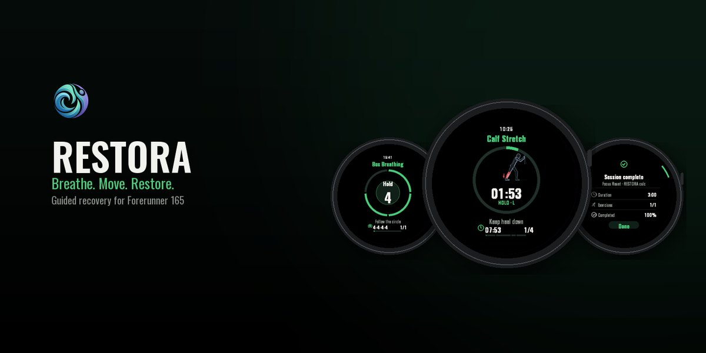
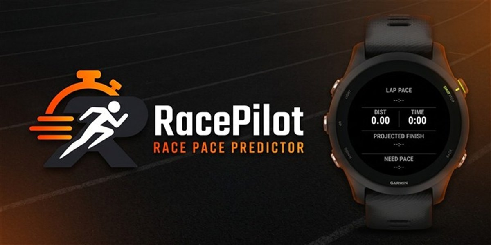
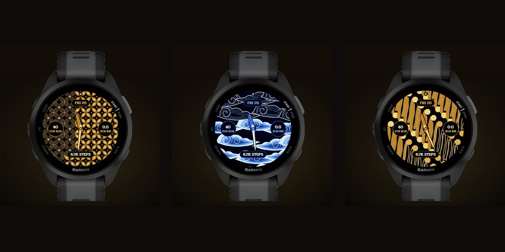

# Garmin Connect IQ apps

Independent Garmin projects, one per folder. Each has its own README with build steps.

| Folder | Project | History |
|---|---|---|
| [`pulseform/`](pulseform/README.md) | **PULSEFORM**: activity-goal watch face for Forerunner 165 | from this repo |
| [`restora/`](restora/README.md) | **RESTORA**: guided recovery for Forerunner 165 | 32 commits, merged from branch `claude/restora-calculation-engine-1n4b9q` |
| [`racepilot/`](racepilot/) | **RacePilot**: race pace predictor | 3 commits, merged from the local repo (`master`) |
| [`watchcraft/`](watchcraft/) | **WatchCraft**: watch face and data field studio | 16 commits, merged from `albiruby/WatchCraft` (`main`) |
| [`batik-watchface/`](batik-watchface/) | **NUSANTARA**: batik watch faces (Kawung, Megamendung, Parang) | first commit here (it was not under git before) |

## PULSEFORM
Activity-goal watch face: 6 faces, 4 looks, a goal track with a scale and a needle.
Shown here: Carbon Balanced, Reflective Dial, Field Horizon and Signal Stack.

[](pulseform/README.md)

## RESTORA
Guided recovery sessions on the watch.

[](restora/README.md)

## RacePilot
Race pace predictor: lap pace, projected finish and the pace still needed.

[](racepilot/)

## WatchCraft
A studio for designing watch faces and data fields, from canvas to `.prg`.

[](watchcraft/)

## NUSANTARA batik watch faces
Kawung, Megamendung and Parang: batik patterns that fill in as you approach your step goal.

[](batik-watchface/)

## Building
Connect IQ projects build from inside their folder, for example:

```powershell
cd pulseform
```
```powershell
$sdk = (Get-Content "$env:APPDATA\Garmin\ConnectIQ\current-sdk.cfg").Trim()
```
```powershell
& "$sdk\bin\monkeyc.bat" -d fr165 -f monkey.jungle -o bin\PulseForm.prg -y <path-to-developer_key.der> -r
```

Signing keys (`*.der`, `*.pem`) and build output (`bin/`) are never committed.
Preview images live in `docs/previews/` and were made from each project's own screenshots and store art.
