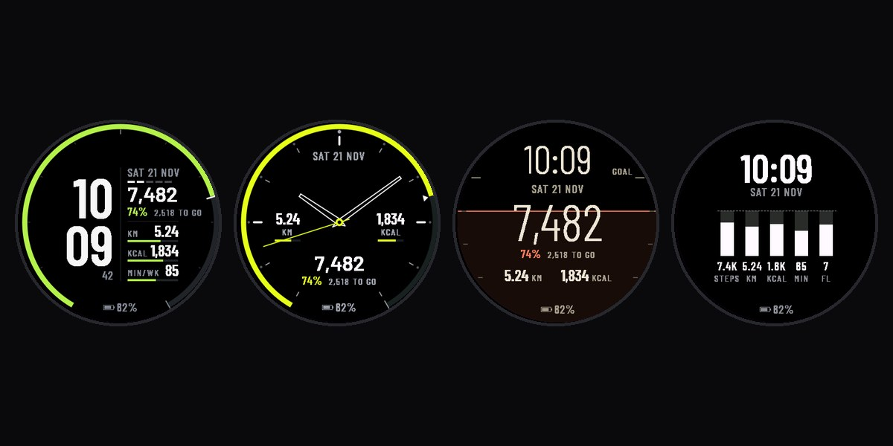
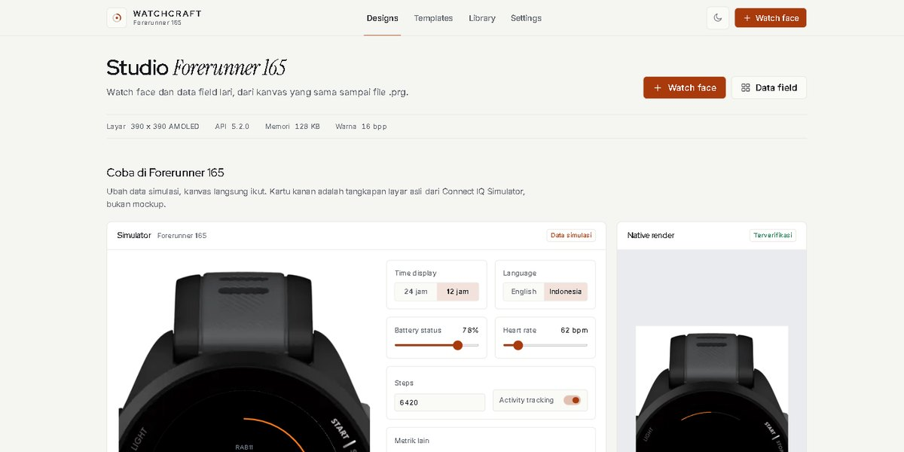

# Garmin

Koleksi project Garmin Connect IQ + tooling data aktivitas. Satu folder per project.

| Folder | Project | Keterangan |
|---|---|---|
| [`Goals Watchface/`](Goals%20Watchface/) | **PULSEFORM** | Activity-goal watch face, Forerunner 165 (390×390 AMOLED) |
| [`RacePilot/`](RacePilot/) | **RacePilot** | Race-pacing data field: lap pace, projected finish, need pace |
| [`Restora/`](Restora/) | **RESTORA** | Guided recovery sessions di jam |
| [`WatchCraft/`](WatchCraft/) | **WatchCraft** | Studio watch face + data field (web + Connect IQ) |
| [`Batik Watchface/`](Batik%20Watchface/) | **NUSANTARA** | Batik watch faces: Kawung, Megamendung, Parang |
| [`Fish Tank App/`](Fish%20Tank%20App/) | **FISH TANK** | Pocket aquarium device app: lari jadi koin untuk akuarium |

> `API-Key-Data-Fetch/` dan `WorkoutMCP/` tetap ada di lokal tapi tidak ikut repo ini.

## PULSEFORM
Activity-goal watch face: 6 faces, 4 looks, goal track dengan skala dan jarum.

[](Goals%20Watchface/)

## RacePilot
Race pace predictor: lap pace, projected finish dan pace yang masih dibutuhkan.

[](RacePilot/)

## RESTORA
Guided recovery sessions di jam.

[](Restora/)

## WatchCraft
Studio untuk mendesain watch face dan data field, dari canvas sampai `.prg`.

[](WatchCraft/)

## NUSANTARA Batik
Kawung, Parang dan Mega Mendung: motif batik yang terisi seiring langkah menuju target harian.

[](Batik%20Watchface/)

## FISH TANK
Akuarium pixel-art di pergelangan tangan. Lari dengan app Run bawaan Garmin menghasilkan koin (100 m = 1 koin) untuk merawat, mengoleksi dan mendekorasi akuarium. 3 art style, 6 tema, 36 spesies, quest, liga dan mini-game.

[](Fish%20Tank%20App/)

## Aturan

- **API key tidak pernah di-commit.** `API-Key-Data-Fetch/garmin-api-key.txt`, `*.der`, `*.pem`, dan `.env` di-ignore di root `.gitignore`.
- Build output (`bin/`, `build/`, `node_modules/`, `.venv/`, `.next/`) tidak ikut repo.
- Gambar preview di `docs/previews/` dibuat dari screenshot dan store art milik project masing-masing.
- Tiap project Connect IQ di-build dari foldernya sendiri, misal:

```powershell
cd "Goals Watchface"
$sdk = (Get-Content "$env:APPDATA\Garmin\ConnectIQ\current-sdk.cfg").Trim()
& "$sdk\bin\monkeyc.bat" -d fr165 -f monkey.jungle -o bin\PulseForm.prg -y <developer_key>.der
```
